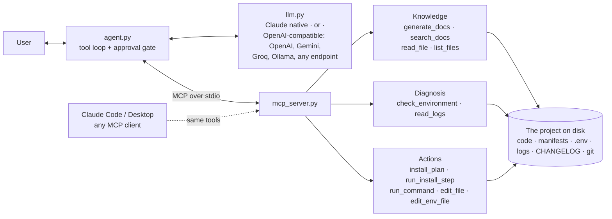

# Project Support Agent

An AI support agent that takes a user from "I have a problem" to "problem solved" for **any** software project. It has two parts:

1. **An MCP server** (`mcp_server.py`). It exposes the project's knowledge and actions as tools: read the docs, check the user's environment, read logs and config, run install steps, apply fixes. Any MCP client can use it, including Claude Code, Claude Desktop and this repo's agent.
2. **A support agent** (`agent.py`). It runs an LLM tool loop over that server. Bring any key: Claude, OpenAI, Gemini, Groq, OpenRouter, DeepSeek, Mistral, xAI, Together, a local Ollama model, or any OpenAI-compatible server. It gathers evidence, diagnoses the root cause, applies the fix (with your approval), and checks that the fix worked.

You point it at a project folder. It needs no per-project configuration: it reads the project's manifests, README, `.env.example`, changelog and git history each time it is asked.

```bash
cd support-agent
uv sync
uv run python test_server.py                  # self-check, no API key needed
uv run python agent.py --setup                # pick provider, paste key, pick model from the live list
uv run python agent.py demo-project "the app won't start since I upgraded"
```

### Plugging in an LLM

`--setup` is the easy path. It checks the key by fetching that provider's live model list, lets you pick a model, and saves everything to `support-agent/.env` (permissions `600`). Environment variables also work, and they override the file:

| You set | Result |
|---|---|
| `ANTHROPIC_API_KEY` | Claude, default model `claude-opus-5-5` |
| `OPENAI_API_KEY` / `GEMINI_API_KEY` (or `GOOGLE_API_KEY`) / `GROQ_API_KEY` / `OPENROUTER_API_KEY` / `DEEPSEEK_API_KEY` / `MISTRAL_API_KEY` / `XAI_API_KEY` / `TOGETHER_API_KEY` + `LLM_MODEL` | That provider. If several keys are set, the first in this list wins |
| `LLM_PROVIDER=ollama` + `LLM_MODEL=<a pulled model>` | Local Ollama, no key |
| `LLM_BASE_URL` (+ `LLM_API_KEY`, `LLM_MODEL`) | Any OpenAI-compatible server: vLLM, LM Studio, a gateway |
| `LLM_PROVIDER` | Forces a provider when several keys are set |

If a key is set but no model is chosen, the agent shows the provider's live model list and asks you to pick.

| File | What it is |
|---|---|
| `mcp_server.py` | The MCP server: 11 tools, project detection, live doc generation, safety rules |
| `agent.py` | The support agent: MCP client + tool loop + an approval step for actions |
| `llm.py` | Pluggable LLM layer: provider presets, key auto-detection, setup wizard, Claude and OpenAI-compatible backends |
| `demo-project/` | A small app with a realistic break: the user upgraded to 1.2.0, but their `.env` still uses a setting name from 1.1 |
| `test_server.py` | Self-check: diagnoses and fixes the demo end to end without an LLM |

---

## Architecture



Nothing sits between the tools and the project: no index, no cache, no copied docs. Every answer is read from the disk at the time of the call.

---

## WHY: design decisions and trade-offs

### 1. Why MCP

The brief asks for the project's knowledge and actions to be usable by "the agent, or any MCP client". MCP is the standard way to do that, and it gives three concrete benefits:

- **One implementation, many front-ends.** The same tools work in my agent, in Claude Code, in Claude Desktop, or in a future web chat. Support logic lives in one place.
- **Tools describe themselves.** The client learns the tool names, input schemas and descriptions at runtime, so adding a tool requires no change to the agent.
- **Safety metadata travels with the tool.** Each tool has an MCP annotation (`readOnlyHint`, `destructiveHint`). The agent uses these to decide what needs the user's approval. It contains no hard-coded list of "dangerous" tools.

The server also sends its **troubleshooting playbook** as the MCP `instructions` field. My agent uses that as its system prompt, so any MCP client that loads the server gets the same process: gather evidence, diagnose, fix, verify.

*Trade-off:* an extra process and a protocol layer, compared with calling Python functions directly. That cost is small, and without MCP the "any MCP client" requirement would be impossible.

*Why stdio, not HTTP:* the server has to inspect **the user's machine**: their tool versions, their ports, their `.env`. So it must run locally. Stdio also means no network port to secure and no auth to build. A hosted HTTP server could not see the user's environment.

### 2. Why generic (convention-based), not built for one project

Projects already maintain the source of truth about themselves: `package.json` engines, `pyproject.toml` `requires-python`, `go.mod`, lockfiles, `.env.example`, `CHANGELOG.md`, the README's install section. The server reads these conventions, so it works on a new project with no configuration and stays correct when the project changes.

Detection covers Node (npm, pnpm, yarn, bun), Python, Go, Rust, Docker/Compose and Make.

*Trade-off:* a project with an unusual setup will not be fully understood. Two things cover that gap: the **README's install section takes priority** over derived steps (the project's own words win), and `run_command` / `search_docs` / `read_file` let the agent handle anything the conventions miss.

### 3. Why docs are generated live, with no index

The brief says docs must "come from the current state of the project" and "change with it". The simplest way to guarantee that is to **store nothing**. `generate_docs` rebuilds overview, install, configuration, commands and changes from the files on every call, and stamps the output with the git commit (and whether the tree has uncommitted changes). Stale docs are impossible by construction, not just unlikely.

- Install docs come from the manifests and the README install section.
- The configuration reference comes from `.env.example`, using each key's comment as its description.
- "Changes" combines the latest release notes with **commits since the last git tag**, so unreleased changes appear before anyone writes release notes.
- For teams that want a docs file in the repo, `python mcp_server.py --docs > DOCS.md` in CI regenerates it on every commit.

*Trade-off:* each call re-scans the project. That takes milliseconds for a typical repo. For a large monorepo, add a cache keyed on file modification times (marked `ponytail:` in the code).

### 4. Why keyword search, not embeddings / RAG

In support work, the most valuable query is often a **literal error string** pasted from a terminal. Exact keyword matching finds where that string is defined or documented. Embeddings blur exact matches. Keyword search also needs no vector database and no index to keep in sync, which would bring back the staleness problem from section 3. Doc files rank above code.

*Trade-off:* synonyms are missed. In practice the model reformulates and searches again. Embeddings are the upgrade path if a project's docs get too large to scan per query.

### 5. Safety model

The agent runs commands on someone's machine, so I designed the safety rules before the features:

| Risk | Control |
|---|---|
| Agent runs something harmful | Every tool that is not read-only needs the user's y/n in `agent.py`. Other MCP clients use their own permission prompts, driven by the same annotations |
| Secrets leak into the LLM | `.env` values and secret-looking config lines (`*token*`, `*password*`, `*api_key*`…) are replaced with `<hidden>` in `read_file` and `search_docs`. Log and command output is scrubbed of `password=...`-style pairs and of the literal values of secret-named or long `.env` keys, so `cat .env` shows `<hidden>` |
| Agent overwrites secrets it cannot see | `edit_file` refuses `.env` files. `edit_env_file` changes **one key** and can rename a key while keeping its hidden value |
| Install step destroys user data | `run_install_step` skips `cp a b` when `b` already exists (e.g. a README's `cp .env.example .env` would wipe a real `.env`) |
| Edits break something | Every edit saves `<file>.bak` first |
| Path tricks (`../../etc/passwd`, symlinks) | Every path is resolved and must stay inside `PROJECT_ROOT`; search skips symlinks that point outside it |
| Prompt injection from project files | README, logs and code are untrusted text the model reads, and `run_install_step` runs README commands. The approval prompt is the only control, so read each command before you say yes |
| Long sessions overflow the context | Once tool output in the history passes ~200K chars, older results are cut to a 400-char stub |
| Hung commands, huge output | Timeouts on every command; output capped at 8 KB (the full output goes to `.support-agent/last_run.log`) |

*Trade-off:* `run_command` is powerful by design, because real fixes vary too much for a fixed menu. The control is human approval. For unattended use, the next step would be a command allowlist or running the server in a container.

### 6. Why a hand-written loop, not a framework

`agent.py` is about 100 lines: call the model, run the requested tools, return the results, repeat (capped at 40 rounds per message, so a looping model can't run forever). I chose this over:

- **An SDK's tool runner:** I need an approval step between "the model asked for a tool" and "the tool runs", plus MCP tools over stdio. A plain loop makes both explicit, and it works the same for every provider.
- **Claude Agent SDK / LangChain:** these bring their own Bash and file-edit tools. Those would go around the MCP server and its safety rules, which defeats the design.

### 7. Why the LLM is pluggable, and how

A support tool gets installed by teams with different contracts, budgets and privacy rules. Some can only use a local model. So the agent must not depend on one vendor. `llm.py` gives the loop one small interface (`add_user`, `step`, `add_results`) with two backends:

- **OpenAI-compatible Chat Completions, for everything except Claude.** OpenAI, Gemini, Groq, OpenRouter, DeepSeek, Mistral, xAI, Together, Ollama, vLLM and LM Studio all serve this API. One adapter of about 40 lines covers all of them, and a provider is just a row of `(key variable, base URL)`. *Trade-off against LiteLLM:* LiteLLM covers more providers with zero adapter code, but it is a large dependency that rewrites requests for every provider. One protocol that almost every provider already speaks is smaller and easier to debug.
- **Native Anthropic SDK for Claude.** Claude has features the generic API cannot express, and the agent uses them: `is_error` on tool results, prompt caching, effort control and server-side refusal fallback. Sending Claude through a compatibility layer would silently drop all four.

Details that make "plug in and use" work:

- **No hardcoded third-party model IDs.** They change every few months. The setup step reads the provider's live model list (hiding embedding, audio and image models), which also proves the key works before anything else runs. Only Claude has a default (`claude-opus-5-5`).
- **The agent's key never reaches the project.** Config is read into memory and not copied into the environment. The MCP server runs shell commands, so if the key were in its environment, `env` or a crash dump could show it to the model.
- **Provider quirks are handled:** Pydantic `title` keys are stripped from tool schemas (some servers reject them); Gemini's thought signatures on tool calls are passed back unchanged; tool calls with invalid JSON arguments return an error instead of running; failures are marked `ERROR:` because Chat Completions has no `is_error` field.

### 8. Model and API choices (Claude backend)

- **Claude Opus 5.5 at `effort: high` by default.** Diagnosis takes several steps of reasoning over evidence, and a wrong fix costs more than tokens. Effort and fallback are only sent for this default model, because other Claude models may not accept them.
- **Prompt caching.** Each step re-sends the tools, the system prompt and the whole history, so caching that prefix cuts cost and latency on long sessions.
- **Server-side refusal fallback.** Logs often contain words like "exploit", "attack" or "denied". If a safety filter wrongly declines a request, the API retries on a fallback model, so the user is not stranded halfway through a fix.
- **Errors go back to the model.** Tool failures return as error results that say what went wrong (`ToolError`), so the agent can adjust instead of crashing.

### 9. Verify, don't claim

The playbook forbids saying "fixed" without proof: re-run the failing command or `check_environment`. This rule is what separates finishing the job end to end from giving plausible advice.

---

## HOW it works

### Tools

| Tool | Kind | What it does |
|---|---|---|
| `generate_docs(topic)` | read | Live docs: overview, install, configuration, commands, changes (release notes + commits since the last tag) |
| `search_docs(query)` | read | Keyword search over docs, configs and code, returning `file:line` and context. Doc files rank higher |
| `read_file(path)` | read | Reads a file with secrets hidden |
| `list_files(pattern)` | read | Glob search that skips `.git`, `node_modules`, venvs and build output |
| `check_environment()` | read | OS; each required tool's version against the project's range; dependencies installed or stale; `.env` against `.env.example` (missing, empty, **renamed** keys); ports in use and by which process; disk space |
| `read_logs(lines, grep)` | read | Tails the newest `*.log` files, the last command's output, and any `LOG_PATHS` globs. Counts error-like lines |
| `install_plan()` | read | Ordered install steps, from the README if it has them, otherwise from the manifests |
| `run_install_step(n)` | write | Runs one plan step and returns its output |
| `run_command(cmd)` | write, destructive | Runs any shell command in the project folder |
| `edit_file(path, old, new)` | write | Exact replace, with a backup |
| `edit_env_file(key, value, rename_from)` | write | Sets or renames a `.env` key without exposing the other values |

### Walkthrough: the demo case

`demo-project` is version 1.2.0. Its changelog says `SECRET_KEY` was renamed to `APP_SECRET`, but the user's `.env` still has `SECRET_KEY`. A typical agent run goes like this:

1. **User:** "the app won't start since I upgraded".
2. `check_environment` → `FAIL .env missing keys: APP_SECRET` and `WARN .env keys not in .env.example (renamed or removed?): SECRET_KEY`.
3. `generate_docs("changes")` → the 1.2.0 release notes: *"`SECRET_KEY` is renamed to `APP_SECRET`."*
4. `run_command("python3 app.py --check")` reproduces the crash, and `read_logs` shows `startup failed: missing config 'APP_SECRET'`.
5. **Diagnosis:** a breaking rename in 1.2.0. The old key is still in `.env`.
6. **Fix (approved by the user):** `edit_env_file("APP_SECRET", rename_from="SECRET_KEY")`. The value is kept, and the agent never sees it.
7. **Verify:** `python3 app.py --check` → `config OK`, and `check_environment` reports no failures.

`test_server.py` runs exactly this sequence without the LLM. It also checks that secrets never appear in tool output and that paths cannot escape the project.

### How freshness works

There is no state to update. When the project changes (a new dependency version, a renamed env var, a new changelog entry, a new commit), the next tool call reads the new files. The agent's knowledge is "re-read the project", not "remember the project".

### Use it from Claude Code or Claude Desktop

```bash
claude mcp add project-support -e PROJECT_ROOT=/path/to/project -- uv run --directory /path/to/support-agent python mcp_server.py
```

Claude Desktop (`claude_desktop_config.json`):

```json
{ "mcpServers": { "project-support": {
    "command": "uv",
    "args": ["run", "--directory", "/path/to/support-agent", "python", "mcp_server.py"],
    "env": { "PROJECT_ROOT": "/path/to/project" } } } }
```

---

## Limits and next steps

- **Version ranges:** `satisfies()` covers the common npm and PEP 440 forms, not full semver (no prerelease tags). If a clause cannot be parsed, it is treated as satisfied rather than reported as a false failure.
- **Tested on Linux.** Windows paths are handled for venvs but not tested.
- **Tool-calling quality varies by model.** Small local models often call tools badly or stop early. The playbook and tools are the same for every model, but results are not. For anything beyond simple questions, use a strong tool-calling model.
- **Provider testing:** both backends were tested against a mock server that speaks both protocols. Real keys for each provider were not available.
- **One project per server process.** For several projects, run several servers or make `PROJECT_ROOT` a tool argument.
- **Logs outside the project** (systemd, `~/.app/logs`) need `LOG_PATHS` set.
- **Measuring quality:** the next step is a set of broken-project scenarios (wrong Node version, port in use, missing dependency, renamed config key) scored on "solved and verified" rate. That would also turn model and effort choices into measured decisions.
