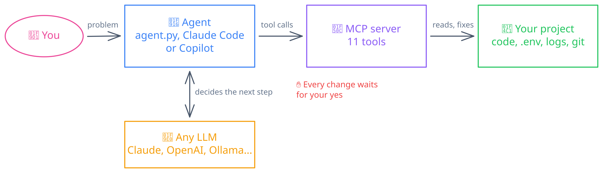
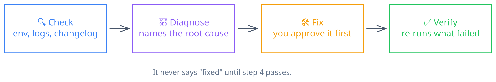

# Project Support Agent

An AI support agent for any software project. You describe the problem. It finds the cause, fixes it with your approval, and proves the fix works.




It has two parts:

- **An MCP server** ([mcp_server.py](mcp_server.py)). It gives the agent 11 tools that read the project and change it.
- **An agent** ([agent.py](agent.py)). It runs any LLM in a loop over those tools.

You do not have to use the agent. Claude Code, Copilot and other MCP clients can use the server directly.

## Quick start

```bash
uv sync
uv run python test_server.py      # self-check, no API key needed
uv run python agent.py --setup    # pick a provider, paste a key, pick a model
uv run python agent.py demo-project "the app won't start since I upgraded"
```

The project needs no config file. The server reads the manifests, README, `.env.example`, changelog and git history on every call.

## What happens when you ask for help



This is a real run on [demo-project/](demo-project/). The user upgraded to 1.2.0, but their `.env` still uses the old key name from 1.1.

| Step | Tool call | Result |
|---|---|---|
| Check | `check_environment` | `FAIL .env missing keys: APP_SECRET` |
| Check | `generate_docs("changes")` | 1.2.0 notes: "`SECRET_KEY` is renamed to `APP_SECRET`" |
| Diagnose | `run_command("python3 app.py --check")` | Crash: `missing config 'APP_SECRET'` |
| Fix | `edit_env_file("APP_SECRET", rename_from="SECRET_KEY")` | You approve. The value stays the same, and the model never sees it. |
| Verify | `run_command("python3 app.py --check")` | `config OK` |

`test_server.py` runs this same sequence without an LLM.

## Choose your LLM

Run `--setup` for the easy path. It checks your key, shows the provider's live model list, and saves your choice to `.env` with permissions `600`.

You can also use environment variables. They override the `.env` file.

| You set | You get |
|---|---|
| `ANTHROPIC_API_KEY` | Claude. The default model is `claude-opus-5-5`. |
| `OPENAI_API_KEY`, `GEMINI_API_KEY`, `GROQ_API_KEY`, `OPENROUTER_API_KEY`, `DEEPSEEK_API_KEY`, `MISTRAL_API_KEY`, `XAI_API_KEY` or `TOGETHER_API_KEY`, plus `LLM_MODEL` | That provider. If you set more than one key, the first one in this list wins. |
| `LLM_PROVIDER=ollama` and `LLM_MODEL` | A local Ollama model. No key. |
| `LLM_BASE_URL`, plus `LLM_API_KEY` and `LLM_MODEL` | Any OpenAI-compatible server, for example vLLM or LM Studio. |

## Use it from other clients

<details>
<summary><b>Claude Code</b></summary>

```bash
claude mcp add project-support -e PROJECT_ROOT=/path/to/project -- \
  uv run --directory /path/to/support-agent python mcp_server.py
```

Run `/mcp` in Claude Code to check that the server is connected.
</details>

<details>
<summary><b>GitHub Copilot (VS Code)</b></summary>

This repo includes [.vscode/mcp.json](.vscode/mcp.json). It points the server at `demo-project`.

1. Open this folder in VS Code.
2. Run **MCP: List Servers** from the Command Palette. Start `project-support`.
3. Open Copilot Chat in **Agent** mode. Ask about the demo app.

Copilot may ignore the server's playbook. If it skips the evidence step, paste the playbook from the top of `mcp_server.py` into the chat.
</details>

<details>
<summary><b>Claude Desktop</b></summary>

Add this to `claude_desktop_config.json`:

```json
{ "mcpServers": { "project-support": {
    "command": "uv",
    "args": ["run", "--directory", "/path/to/support-agent", "python", "mcp_server.py"],
    "env": { "PROJECT_ROOT": "/path/to/project" } } } }
```
</details>

<details>
<summary><b>MCP Inspector (for debugging)</b></summary>

```bash
npx @modelcontextprotocol/inspector -e PROJECT_ROOT=$PWD/demo-project uv run python mcp_server.py
```

It opens a web UI. You can call each tool and see the raw response.
</details>

## Tools

| Tool | Changes things? | What it does |
|---|---|---|
| `generate_docs` | no | Builds docs from the current files: overview, install, config, commands, changes |
| `search_docs` | no | Keyword search over docs, configs and code. Returns `file:line` |
| `read_file` | no | Reads a file. Secrets show as `<hidden>` |
| `list_files` | no | Glob search. Skips `.git`, `node_modules`, venvs and build output |
| `check_environment` | no | Checks tool versions, dependencies, `.env` keys, ports and disk space |
| `read_logs` | no | Shows the end of the newest log files and the last command output |
| `install_plan` | no | Lists the install steps from the README or the manifests |
| `run_install_step` | yes | Runs one install step |
| `run_command` | yes | Runs a shell command in the project folder |
| `edit_file` | yes | Replaces exact text in a file. Saves a `.bak` first |
| `edit_env_file` | yes | Sets or renames one `.env` key. The model never sees the other values |

Detection supports Node (npm, pnpm, yarn, bun), Python, Go, Rust, Docker, Compose and Make.

## Safety

The agent runs commands on your machine. These rules limit what it can do.

| Risk | What stops it |
|---|---|
| A harmful command | Each tool that changes things waits for your `y`. Other MCP clients use their own approval prompts. |
| Secrets in the model's context | The server hides `.env` values and lines like `password=...` in files, logs and command output. |
| Lost secrets during an edit | `edit_file` refuses `.env` files. `edit_env_file` changes one key and keeps the hidden value. |
| An install step that overwrites `.env` | `run_install_step` skips `cp a b` when `b` exists. |
| Path tricks such as `../../etc/passwd` | Every path must resolve inside `PROJECT_ROOT`. Search skips symlinks that point outside it. |
| Instructions hidden in project files | The model reads the README, logs and code as plain text. Your approval is the only control here, so read each command before you say yes. |
| Hung commands or very large output | Every command has a timeout. Output stops at 8 KB. The full output goes to `.support-agent/last_run.log`. |

## Why it works this way

<details>
<summary><b>Why MCP</b></summary>

One server works in many clients: this agent, Claude Code, Copilot and Claude Desktop. Each tool carries a read-only or destructive flag, so a client knows which calls need approval without a hard-coded list. The server also sends its playbook as the MCP `instructions` field, so every client can follow the same check, diagnose, fix, verify process.

The server uses stdio, not HTTP, because it must inspect your machine: your tool versions, ports and `.env`. A hosted server cannot see those.
</details>

<details>
<summary><b>Why no stored docs or index</b></summary>

Stored docs get stale. This server stores nothing. `generate_docs` rebuilds the docs from the files on each call and adds the git commit to the output. The "changes" section shows the latest release notes plus every commit since the last tag.

To keep a docs file in the repo, run `python mcp_server.py --docs > DOCS.md` in CI.
</details>

<details>
<summary><b>Why keyword search, not embeddings</b></summary>

Users often paste an exact error string. Keyword search finds the exact place that string comes from. Embeddings blur exact matches and need an index, and an index can get stale. Doc files rank above code.

Keyword search misses synonyms. When that happens, the model searches again with other words.
</details>

<details>
<summary><b>Why a hand-written loop, not a framework</b></summary>

[agent.py](agent.py) is about 100 lines. It must stop for your approval between "the model asks for a tool" and "the tool runs". A plain loop makes that step easy to see. Frameworks like LangChain bring their own shell and file tools, and those tools bypass the server's safety rules.
</details>

<details>
<summary><b>Why the LLM is pluggable</b></summary>

Teams have different budgets and privacy rules. Some can use only a local model. [llm.py](llm.py) has two backends:

- **Claude** uses the Anthropic SDK. This gives it error flags on tool results, prompt caching, effort control and a fallback model when a safety filter refuses a request by mistake.
- **Everything else** uses the OpenAI-compatible Chat Completions API. One adapter of about 40 lines covers OpenAI, Gemini, Groq, Ollama and the rest.

The code has no hard-coded model IDs except the Claude default. `--setup` reads the provider's live model list instead.

The agent's API key never reaches the server's environment. The server runs shell commands, and a command like `env` could show the key to the model.
</details>

## Limits

- Version checks cover common npm and PEP 440 ranges. They do not support prerelease tags.
- I tested it on Linux only.
- Small local models often call tools badly or stop early. Use a strong tool-calling model.
- I tested both LLM backends against a mock server, not with real keys for every provider.
- One server process handles one project. For more projects, run more servers.
- For logs outside the project, set `LOG_PATHS`.

## Files

| File | What it is |
|---|---|
| [mcp_server.py](mcp_server.py) | The MCP server: tools, project detection, safety rules |
| [agent.py](agent.py) | The agent: tool loop and approval step |
| [llm.py](llm.py) | LLM backends, provider presets and the setup wizard |
| [test_server.py](test_server.py) | Self-check that fixes the demo without an LLM |
| [demo-project/](demo-project/) | A small app with a broken upgrade |
| [docs/](docs/) | Diagrams. The `.excalidraw` files are editable at [excalidraw.com](https://excalidraw.com). |
